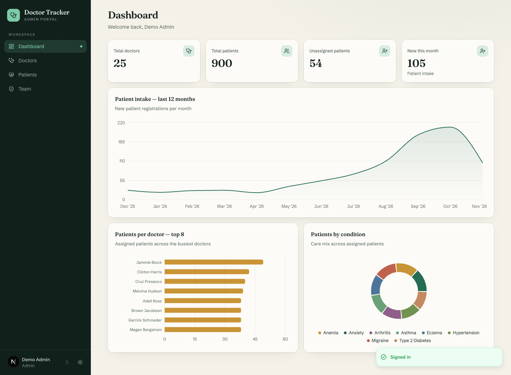
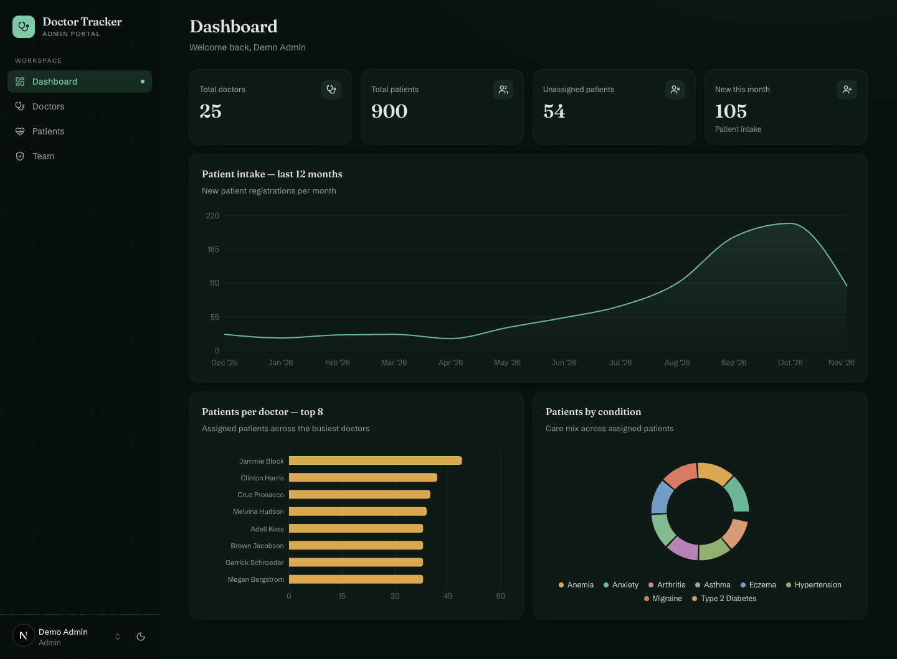
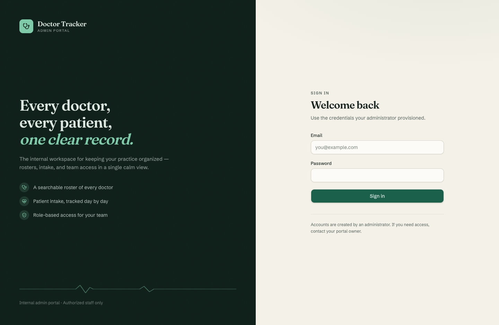
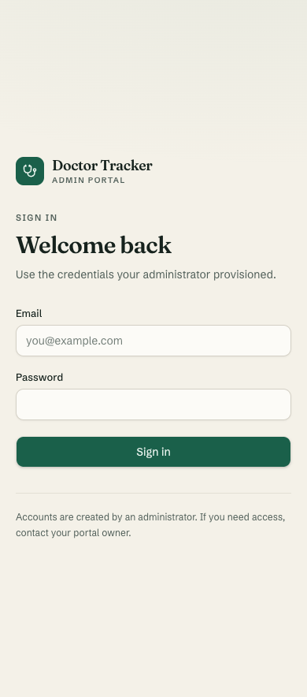
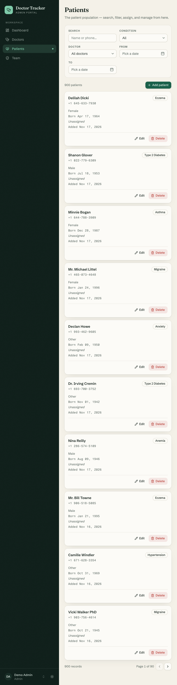

# Doctor Tracker

A secure admin portal for a small clinic network: manage a roster of doctors, track the patients assigned to them, and see the whole operation at a glance on a live dashboard. Role-based access (Admin vs Staff), fast indexed search and filtering over ~1,000 seeded records, and a responsive light/dark UI — built as a Next.js client talking to a standalone Express REST API over MongoDB.

## Demo credentials

Sign-up is disabled; users are provisioned internally by an Admin (Team page) or by the seed script.

| Role  | Email                  | Password      | Access                                                                 |
| ----- | ---------------------- | ------------- | ---------------------------------------------------------------------- |
| Admin | `admin@doctracker.dev` | `Admin#12345` | Everything: doctor CRUD, patient CRUD, team management, dashboard      |
| Staff | `staff@doctracker.dev` | `Staff#12345` | View doctors/dashboard; create/edit/assign/unassign patients. No deletes, no doctor writes, no team access |

## Screenshots

Desktop (1440px), tablet (768px), and mobile (390px), light and dark themes. More views (doctors, doctor detail, team) are in [`docs/screenshots/`](docs/screenshots/).

| Desktop — light | Desktop — dark |
| --- | --- |
|  |  |

| Mobile — light | Mobile — dark |
| --- | --- |
|  |  |

| Patients (desktop) | Patients (mobile cards) |
| --- | --- |
|  |  |

| Sign-in (desktop) | Sign-in (mobile) |
| --- | --- |
|  |  |

| Patients (tablet, 768px) |
| --- |
|  |

## Getting started

### Prerequisites

- [Bun](https://bun.sh) v1.2+
- MongoDB running locally (`mongodb://127.0.0.1:27017`) or an Atlas connection string

### 1. Install

```bash
bun install
```

The postinstall step runs Varlock codegen, which generates a typed `src/env.ts` from each app's `.env.schema`.

### 2. Configure environment

Copy the example files and fill in real values (never commit the real `.env` files):

```bash
cp apps/server/.env.example apps/server/.env
cp apps/web/.env.example apps/web/.env
```

`apps/server/.env`:

| Variable             | Example                                    | Notes                              |
| -------------------- | ------------------------------------------ | ---------------------------------- |
| `NODE_ENV`           | `development`                              |                                    |
| `BETTER_AUTH_SECRET` | *(random string, 32+ chars)*               | e.g. `openssl rand -base64 32`     |
| `BETTER_AUTH_URL`    | `http://localhost:3000`                    | API origin                         |
| `CORS_ORIGIN`        | `http://localhost:3001`                    | Web origin                         |
| `DATABASE_URL`       | `mongodb://127.0.0.1:27017/doctor-tracker` | Local or Atlas URI                 |
| `PORT`               | `3000`                                     | Optional, defaults to 3000         |

`apps/web/.env`:

| Variable                 | Example                 | Notes                        |
| ------------------------ | ----------------------- | ---------------------------- |
| `NODE_ENV`               | `development`           |                              |
| `NEXT_PUBLIC_SERVER_URL` | `http://localhost:3000` | Used by Next.js API rewrites |

Schemas are validated at boot (fail-fast on missing/invalid values). `packages/db` and `packages/auth` receive configuration from the apps — they own no secrets of their own.

### 3. Seed demo data

```bash
cd apps/server && bun run seed
```

Creates 25 doctors and 900 patients spread across the last 12 months (~6% unassigned), plus the two demo users above. Deterministic (fixed faker seed), idempotent, and safe to re-run.

### 4. Run

```bash
bun run dev
```

- Web: [http://localhost:3001](http://localhost:3001)
- API: [http://localhost:3000](http://localhost:3000) (`GET /health`)

### 5. Verify

```bash
bun run test         # 35 tests: service layer against an in-memory MongoDB + policy unit tests
bun run check-types  # strict TypeScript across all 5 packages
```

## Architecture overview

Turborepo monorepo with two apps and four shared packages:

```
apps/
  web/       Next.js App Router client (Vercel-ready)
  server/    Express REST API (standalone Node/Bun process)
packages/
  auth/      better-auth config (admin plugin, rate limits) + pure role policy
  db/        Mongoose models, indexes, shared Zod schemas
  ui/        shadcn/ui primitives + DataTable, FilterBar, Pagination, StatCard, ConfirmDialog, charts
  config/    shared TypeScript configs
```


**Request lifecycle.** The browser only ever talks to the Next.js origin. Next.js rewrites `/api/auth/*` and `/api/v1/*` to Express, so session cookies stay first-party (see decision 2). On the server, every `/api/v1` request passes `requireAuth` (401 without a session) and then a per-route `requireCapability` check (403 when the role lacks the capability). Routes stay thin: they wire middleware to controllers; controllers parse input with shared Zod schemas and call services; services own all MongoDB access. One central error middleware maps `AppError`, Zod failures, and duplicate-key errors to a uniform envelope — no per-controller try/catch, no stack traces to clients:

```json
{ "success": true, "data": [...], "meta": { "total": 900, "page": 1, "limit": 10 } }
{ "success": false, "error": { "code": "CONFLICT", "message": "…" } }
```

**Data model.** `patients` reference a `doctor` (optional — `null` means *unassigned*). Deleting a doctor unassigns their patients first; the records survive. Deleting a patient is permanent and Admin-only. Both collections carry `timestamps` and compound indexes ordered equality → sort → range, and all list filtering/pagination happens in MongoDB (never in JS).

**Client state.** TanStack Query owns server state (`keepPreviousData` for flicker-free pagination, optimistic unassign with rollback + toast). Filters, search, and page live in the URL, so views are refreshable and shareable. Forms are React Hook Form + Zod using the same schemas the server validates with.

### API surface (all under `/api/v1`, session required)

| Method | Path              | Capability        |
| ------ | ----------------- | ----------------- |
| GET    | `/dashboard`      | `dashboard:read`  |
| GET    | `/doctors`        | `doctor:read`     |
| GET    | `/doctors/:id`    | `doctor:read`     |
| POST   | `/doctors`        | `doctor:create`   |
| PATCH  | `/doctors/:id`    | `doctor:update`   |
| DELETE | `/doctors/:id`    | `doctor:delete`   |
| GET    | `/patients`       | `patient:read`    |
| GET    | `/patients/:id`   | `patient:read`    |
| POST   | `/patients`       | `patient:create`  |
| PATCH  | `/patients/:id`   | `patient:update` (assignment-only patches also accept `patient:assign`) |
| DELETE | `/patients/:id`   | `patient:delete`  |

List endpoints accept `search`, `page`, `limit` (capped at 100), `from`/`to` dates, plus `specialization`/`hospital` (doctors) and `condition`/`doctor` (patients, `doctor=unassigned` supported). Auth endpoints (`/api/auth/*`) are handled by better-auth with sign-in rate limiting.

## Technical decisions

### 1. Index-backed prefix search on normalized lowercase fields

**Problem.** The portal needs "search as you type" over doctor name/email/hospital and patient name/phone. The obvious implementation — `{ name: { $regex: query, $options: "i" } }` — is a collection scan: an unanchored, case-insensitive regex cannot use a B-tree index, so latency grows linearly with the collection.

**Decision.** Each searchable field gets a lowercase *shadow field* (`nameLower`, `emailLower`, …) maintained on write, indexed with the collection's compound indexes. Search builds an **anchored, case-sensitive prefix pattern** (`^` + escaped user input) against the shadow field. Anchored regexes are a range scan on the index — `IXSCAN`, not `COLLSCAN` — and escaping user input keeps regex metacharacters literal. The trade-off is prefix-only matching (no mid-word search), which fits "find Dr. Smith" / "find hospital starting with…" and is honest about what an index can do. Full-text search would be the next step if mid-word matching became a requirement.

**Proof.** Service tests run the actual queries against an in-memory MongoDB and assert `explain()` reports `IXSCAN` for every search/filter path, plus correctness of the escaping (e.g. searching `a.b` matches literally). Details in [ADR-0001](docs/adr/0001-prefix-search-on-normalized-lowercase-fields.md).

### 2. First-party cookies via Next.js rewrites instead of cross-origin CORS

**Problem.** The assessment mandates a *separate* client and API server. The naive wiring — browser fetches `http://api-host` directly with `credentials: "include"` — makes the session cookie third-party. Safari blocks third-party cookies outright, Chrome is phasing them out, and incognito windows (the reviewer's test environment) break login. CORS with credentials also widens the attack surface.

**Decision.** The browser talks only to the Next.js origin; `next.config.ts` rewrites `/api/auth/:path*` and `/api/v1/:path*` to the Express server. Cookies are set on the web origin, so they are first-party, `SameSite=Lax`, and work in incognito and strict browsers with no CORS preflights for browser traffic. The Next.js server-side session guard forwards the incoming cookies to Express to validate sessions before rendering protected pages (fail-closed). The cost is one extra hop and a rewrite rule to keep in sync — cheap compared to debugging third-party cookie failures in a reviewer's browser. Express still sends CORS headers for non-browser API consumers. Details in [ADR-0002](docs/adr/0002-first-party-api-cookies-via-nextjs-rewrites.md).

## Testing & verification

- **35 automated tests** (`bun test`): doctor/patient/dashboard services against `mongodb-memory-server` (search, filters, pagination caps, date bounds, unassign-on-delete, duplicate email → 409, aggregation shape, `IXSCAN` assertions) and the role policy matrix.
- **End-to-end browser pass** (Playwright, fresh incognito-equivalent contexts): route guards, both role logins, every filter + URL persistence, pagination, create/edit/delete/unassign with confirm dialogs and optimistic updates, team create/ban/unban, staff 403s at API and UI level, dashboard charts, and mobile card layouts at 390px — in light and dark themes, with zero console errors.

## Scripts

| Command                | Purpose                                  |
| ---------------------- | ---------------------------------------- |
| `bun run dev`          | Run web + server (Turborepo)             |
| `bun run build`        | Build all apps                           |
| `bun run test`         | Run all test suites                      |
| `bun run check-types`  | Strict typecheck across the monorepo     |
| `bun run env:generate` | Regenerate typed env accessors           |
| `cd apps/server && bun run seed` | Reset + reseed demo data       |