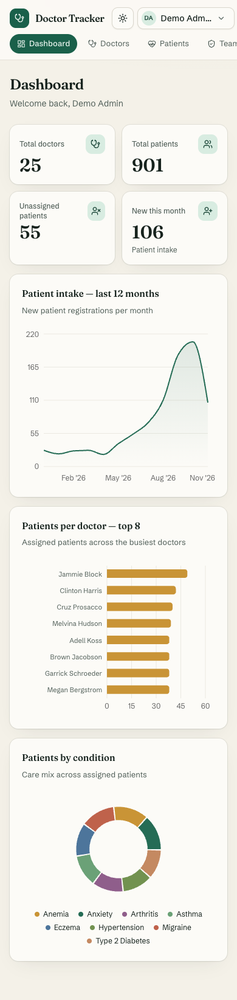
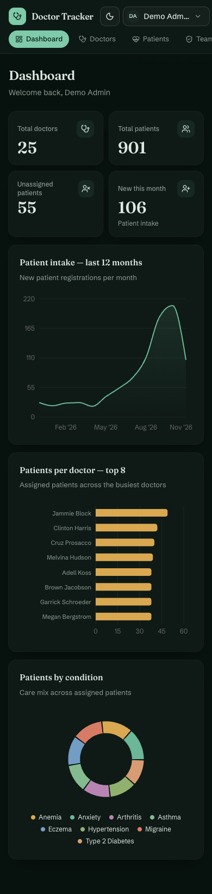
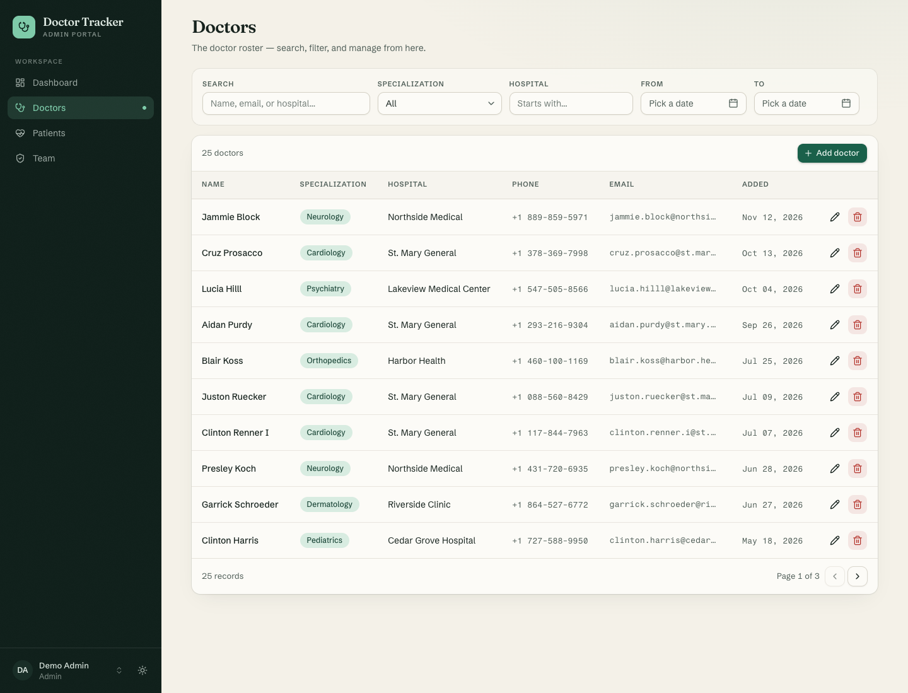
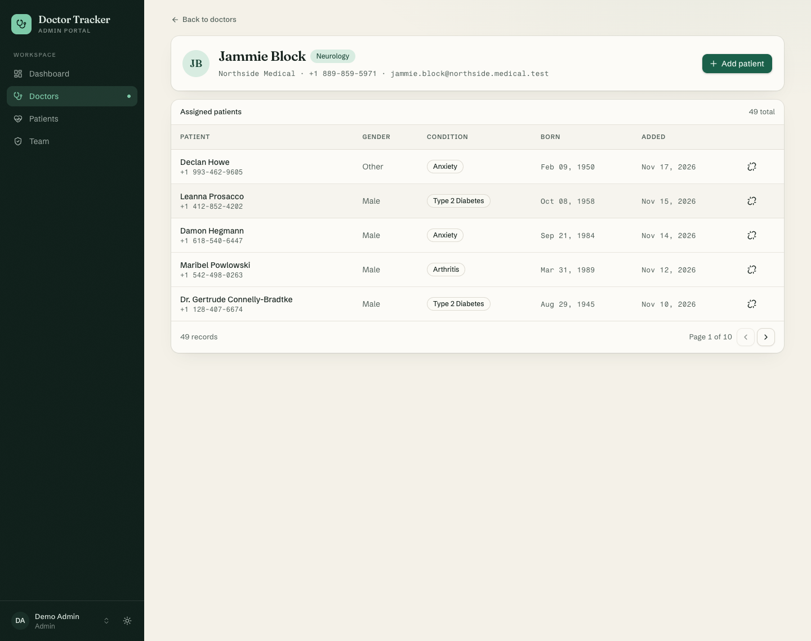
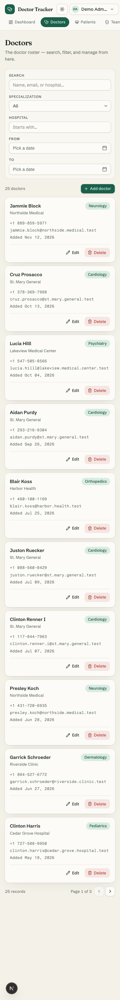
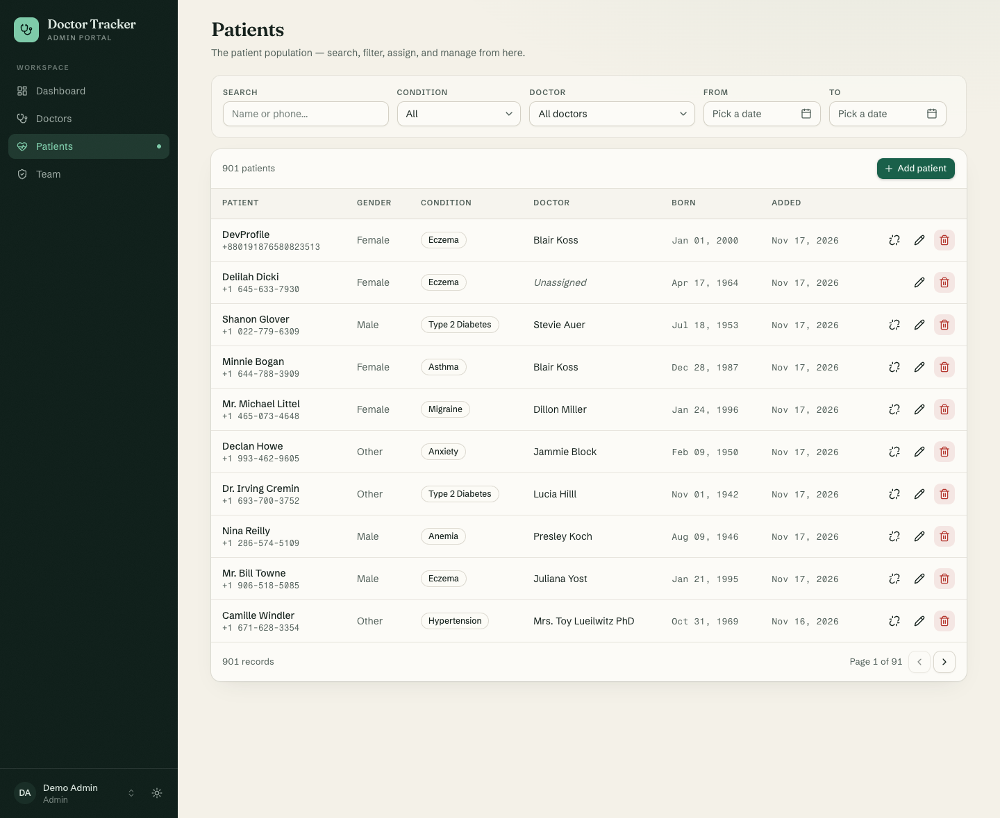
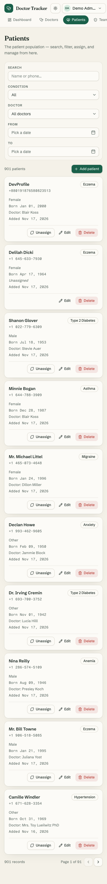
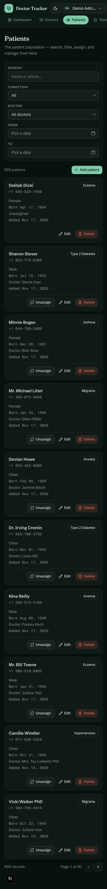
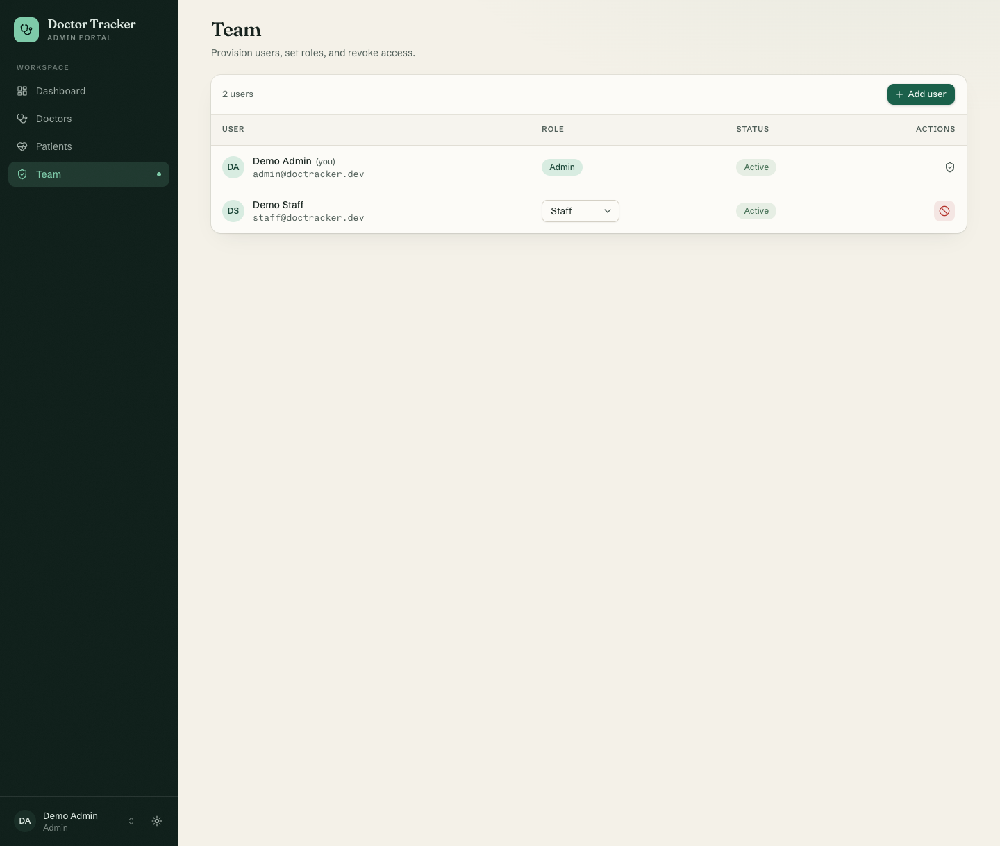
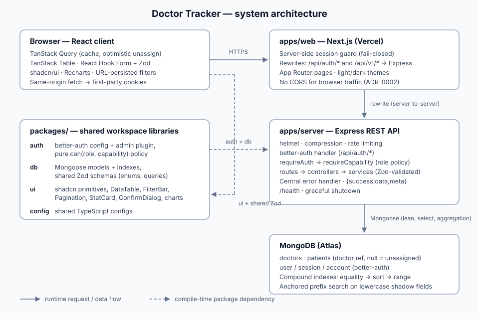

# Doctor Tracker

> A secure, role-aware admin portal for a small clinic network — manage doctors, track their patients, and read the whole operation at a glance on a live dashboard. Built as a **Next.js client + standalone Express REST API over MongoDB**, with a hand-tuned light/dark design system and a fully responsive layout from 390px to 1440px+.


**Live demo: [https://doc-tracker-web-one.vercel.app](https://doc-tracker-web-one.vercel.app/)**

| Desktop — light | Desktop — dark |
| --- | --- |
|  |  |

---

## Try the demo

Open the [live demo](https://doc-tracker-web-one.vercel.app/) and sign in with either role below. Sign-up is deliberately disabled — accounts are provisioned internally by an Admin (Team page) or by the seed script. Use either role to explore the permission model:

| Role  | Email                  | Password      | What you can do |
| ----- | ---------------------- | ------------- | --------------- |
| **Admin** | `admin@doctracker.dev` | `Admin#12345` | Everything: doctor CRUD, patient CRUD, team management (create / ban / unban), dashboard |
| **Staff** | `staff@doctracker.dev` | `Staff#12345` | Read doctors + dashboard; create / edit / assign / unassign patients. **No** deletes, **no** doctor writes, **no** team access |

> Sign in as **Staff** to see the UI adapt: delete buttons disappear, doctor forms go read-only, and the Team nav item is hidden — while the API independently returns `403` for the same operations. Permissions are enforced server-side, never just hidden in the client.

---

## Highlights

- **Live dashboard** — KPI stat cards plus three meaningful charts (12-month patient intake area chart, patients-per-doctor bar chart, condition-mix donut), all computed by MongoDB aggregation, not in JS.
- **Doctor roster** — indexed search-as-you-type over name / email / hospital, specialization / hospital filters, date-range filtering, pagination, and full create / edit / delete with confirm dialogs.
- **Doctor detail** — per-doctor assigned-patient list with one-click unassign and "add patient under this doctor" (assignment pre-locked). Removing a patient from a doctor only *unassigns* them — the record survives in the unassigned pool; permanent deletion is Admin-only, from the Patients page.
- **Patients** — name / phone search, condition / doctor filters (including an *unassigned* pool), date range, pagination; assign / reassign / unassign; optimistic updates with rollback + toast.
- **Team & roles** — Admin-provisioned users, role assignment, ban / unban, backed by the better-auth admin plugin and a pure, unit-tested capability policy.
- **Craft** — a distinctive editorial design system (Fraunces display + Schibsted Grotesk body, warm bone / evergreen tokens), full light **and** dark themes, custom date-picker, skeleton loaders, empty / error states with retry, URL-persisted filters, and keyboard-accessible dialogs, selects and tables.
- **Fully responsive** — data tables on desktop collapse to action-rich cards on mobile; every surface verified at 390 / 768 / 1024 / 1440px in both themes with zero horizontal overflow.

---

## Screenshots

Captured from the running app at real breakpoints, light and dark. Full set in [`docs/screenshots/`](docs/screenshots/).

### Dashboard

| Mobile — light | Mobile — dark |
| --- | --- |
|  |  |

### Doctors

| Roster (desktop) | Doctor detail (desktop) |
| --- | --- |
|  |  |

| Roster (mobile cards) |
| --- |
|  |

### Patients

| Desktop table | Tablet (768px) |
| --- | --- |
|  |  |

| Mobile — light | Mobile — dark |
| --- | --- |
|  |  |

### Team & sign-in

| Team (desktop) | Sign-in (desktop) |
| --- | --- |
|  |  |

| Sign-in (mobile) |
| --- |
|  |

---

## Architecture

Turborepo monorepo: two apps, four shared packages.

```
apps/
  web/       Next.js App Router client (Vercel-ready) — organized by feature:
             app/ holds thin route files + root providers; features/<domain>/
             own api.ts (typed fetchers), queries.ts (query-key factory +
             hooks) and components/; shell/ is the app chrome (sidebar,
             header, account menus); hooks/ the shared cross-feature hooks;
             lib/ the non-React infrastructure (fetch wrapper, envelope
             errors, auth client, session)
  server/    Express REST API (standalone Node/Bun process)
packages/
  auth/      better-auth config (admin plugin, rate limits) + pure role policy
  db/        Mongoose models, indexes, shared Zod schemas
  ui/        design-system primitives + DataTable, FilterBar, Pagination,
             StatCard, ConfirmDialog, DatePicker, charts
  config/    shared TypeScript configs
```



**Request lifecycle.** The browser only ever talks to the Next.js origin. Next.js rewrites `/api/auth/*` and `/api/v1/*` to Express, so session cookies stay first-party (see [decision 2](#2-first-party-cookies-via-nextjs-rewrites-instead-of-cross-origin-cors)). On the server, every `/api/v1` request passes `requireAuth` (401 without a session) then a per-route `requireCapability` check (403 when the role lacks the capability). Routes stay thin: they wire middleware to controllers; controllers parse input with shared Zod schemas and call services; services own all MongoDB access. One central error middleware maps `AppError`, Zod failures and duplicate-key errors to a uniform envelope — no per-controller try/catch, no stack traces to clients:

```json
{ "success": true,  "data": [...], "meta": { "limit": 10, "hasMore": true, "nextCursor": "eyJjIjoiMjAyNi0wMS0xNVQxMjowMDowMC4wMDBaIiwiaSI6IjY4YTFlMmYzYTRiNWM2ZDdlOGY5MDEyMyJ9", "total": 900, "totalPages": 90 } } // first page — the only one that pays for a count
{ "success": true,  "data": [...], "meta": { "limit": 10, "hasMore": false, "nextCursor": null } } // later pages — cursor walk only, totals are not recomputed
{ "success": false, "error": { "code": "CONFLICT", "message": "…" } }
```

**Data model.** `patients` reference a `doctor` (optional — `null` means *unassigned*). Deleting a doctor unassigns their patients first; the records survive. Deleting a patient is permanent and Admin-only. Both collections carry `timestamps` and compound indexes ordered equality → sort → range, each suffixed `_id: -1` so the keyset sort is fully index-covered, and all list filtering / pagination happens in MongoDB (never in JS).

**Client state.** TanStack Query owns server state (`keepPreviousData` for flicker-free pagination, optimistic unassign with rollback + toast). Filters, page position and the pagination cursor live in the URL, so views are refreshable and shareable. Forms are React Hook Form + Zod using the *same* schemas the server validates with — client and server validation can never drift.

### API surface (all under `/api/v1`, session required)

| Method | Path              | Capability        |
| ------ | ----------------- | ----------------- |
| GET    | `/dashboard`      | `dashboard:read`  |
| GET    | `/doctors`        | `doctor:read`     |
| GET    | `/doctors/:id`    | `doctor:read`     |
| POST   | `/doctors`        | `doctor:create`   |
| PATCH  | `/doctors/:id`    | `doctor:update`   |
| DELETE | `/doctors/:id`    | `doctor:delete`   |
| GET    | `/patients`       | `patient:read`    |
| GET    | `/patients/:id`   | `patient:read`    |
| POST   | `/patients`       | `patient:create`  |
| PATCH  | `/patients/:id`   | `patient:update` (assignment-only patches also accept `patient:assign`) |
| DELETE | `/patients/:id`   | `patient:delete`  |

List endpoints paginate by keyset cursor (ADR-0003): `cursor` resumes a listing, `limit` is capped at 100, and the response `meta` carries `hasMore` + `nextCursor`; `total`/`totalPages` ride only a listing's first page. They also accept `search` and `from`/`to` dates, plus `specialization`/`hospital` (doctors) and `condition`/`doctor` (patients, `doctor=unassigned` supported). Auth endpoints (`/api/auth/*`) are handled by better-auth with sign-in rate limiting.

---

## Technical decisions

### 1. Index-backed prefix search on normalized lowercase fields

**Problem.** The portal needs "search as you type" over doctor name/email/hospital and patient name/phone. The obvious implementation — `{ name: { $regex: query, $options: "i" } }` — is a collection scan: an unanchored, case-insensitive regex cannot use a B-tree index, so latency grows linearly with the collection.

**Decision.** Each searchable field gets a lowercase *shadow field* (`nameLower`, `emailLower`, …) maintained on write and indexed with the collection's compound indexes. Search builds an **anchored, case-sensitive prefix pattern** (`^` + escaped user input) against the shadow field. Anchored regexes are a range scan on the index — `IXSCAN`, not `COLLSCAN` — and escaping user input keeps regex metacharacters literal. The trade-off is prefix-only matching (no mid-word search), which fits "find Dr. Smith" / "find hospital starting with…" and is honest about what an index can do. Full-text search would be the next step if mid-word matching became a requirement.

**Proof.** Service tests run the actual queries against an in-memory MongoDB and assert `explain()` reports `IXSCAN` for every search/filter path, plus correctness of the escaping (e.g. searching `a.b` matches literally). Details in [ADR-0001](docs/adr/0001-prefix-search-on-normalized-lowercase-fields.md).

### 2. First-party cookies via Next.js rewrites instead of cross-origin CORS

**Problem.** The assessment mandates a *separate* client and API server. The naive wiring — browser fetches `http://api-host` directly with `credentials: "include"` — makes the session cookie third-party. Safari blocks third-party cookies outright, Chrome is phasing them out, and incognito windows (the reviewer's test environment) break login. CORS with credentials also widens the attack surface.

**Decision.** The browser talks only to the Next.js origin; `next.config.ts` rewrites `/api/auth/:path*` and `/api/v1/:path*` to the Express server. Cookies are set on the web origin, so they are first-party, `SameSite=Lax`, and work in incognito and strict browsers with no CORS preflights for browser traffic. The Next.js server-side session guard forwards the incoming cookies to Express to validate sessions before rendering protected pages (fail-closed). The cost is one extra hop and a rewrite rule to keep in sync — cheap compared to debugging third-party cookie failures in a reviewer's browser. Express still sends CORS headers for non-browser API consumers. Details in [ADR-0002](docs/adr/0002-first-party-api-cookies-via-nextjs-rewrites.md).

---

### 3. Keyset pagination, dashboard caching, and connection pool sizing

**Problem.** The spec requires the data layer to be optimized. Three hot spots: offset pagination gets slower linearly with depth (`skip(5000)` reads and discards 5,000 rows per request) and paid for a `count` on every page; the dashboard recomputed 7 aggregation pipelines on every visit; the Mongo connection pool ran on driver defaults regardless of the deployment target.

**Decision.** List endpoints paginate by **keyset cursor** — an opaque base64url token of the last row's `(createdAt, _id)` position — so page *N* reads exactly `limit + 1` rows at any depth, and the count runs only on the first page of a listing (the one place the pager shows totals). Every compound list index ends in `createdAt: -1, _id: -1` so the sort is fully index-covered. The **dashboard summary is cached in process memory** (60s TTL) with a generation counter that every patient/doctor mutation bumps, so own writes reflect immediately; on serverless each warm instance holds its own copy and the TTL bounds cross-instance staleness. **Pool sizing is env-configurable** (`DB_MAX_POOL_SIZE`, `DB_MIN_POOL_SIZE`, `DB_MAX_IDLE_TIME_MS`, `DB_SERVER_SELECTION_TIMEOUT_MS`) with driver-safe defaults, so a long-running host can run a larger warm pool while many serverless instances each keep a small pool inside the Atlas connection budget. The keyset change is a breaking API contract change (strict parsing now rejects the legacy `page` param). Details in [ADR-0003](docs/adr/0003-keyset-cursor-pagination.md).

---

## Getting started

### Prerequisites

- [Bun](https://bun.sh) v1.2+
- MongoDB running locally (`mongodb://127.0.0.1:27017`) or an Atlas connection string

### 1. Install

```bash
bun install
```

The postinstall step runs Varlock codegen, which generates a typed `src/env.ts` from each app's `.env.schema`.

### 2. Configure environment

Copy the example files and fill in real values (never commit the real `.env` files):

```bash
cp apps/server/.env.example apps/server/.env
cp apps/web/.env.example apps/web/.env
```

`apps/server/.env`:

| Variable             | Example                                    | Notes                              |
| -------------------- | ------------------------------------------ | ---------------------------------- |
| `NODE_ENV`           | `development`                              |                                    |
| `BETTER_AUTH_SECRET` | *(random string, 32+ chars)*               | e.g. `openssl rand -base64 32`     |
| `BETTER_AUTH_URL`    | `http://localhost:3000`                    | API origin                         |
| `CORS_ORIGIN`        | `http://localhost:3001`                    | Web origin                         |
| `DATABASE_URL`       | `mongodb://127.0.0.1:27017/doctor-tracker` | Local or Atlas URI                 |
| `PORT`               | `3000`                                     | Optional, defaults to 3000         |
| `DB_MAX_POOL_SIZE`    | `10`                                       | Optional pool knobs (see decision 3) |
| `DB_MIN_POOL_SIZE`    | `0`                                        | 〃                                  |
| `DB_MAX_IDLE_TIME_MS` | `30000`                                    | 〃                                  |

`apps/web/.env`:

| Variable                 | Example                 | Notes                        |
| ------------------------ | ----------------------- | ---------------------------- |
| `NODE_ENV`               | `development`           |                              |
| `NEXT_PUBLIC_SERVER_URL` | `http://localhost:3000` | Used by Next.js API rewrites |

Schemas are validated at boot (fail-fast on missing/invalid values). `packages/db` and `packages/auth` receive configuration from the apps — they own no secrets of their own.

### 3. Seed demo data

```bash
cd apps/server && bun run seed
```

Creates 25 doctors and ~900 patients spread across the last 12 months (~6% unassigned), plus the two demo users above. Deterministic (fixed faker seed), idempotent, and safe to re-run.

### 4. Run

```bash
bun run dev
```

- Web: [http://localhost:3001](http://localhost:3001)
- API: [http://localhost:3000](http://localhost:3000) (`GET /health`)

### 5. Verify

```bash
bun run test         # service layer against in-memory MongoDB + policy unit tests
bun run check-types  # strict TypeScript across all packages
```

---

## Testing & verification

- **40 automated tests** (`bun test`): doctor / patient / dashboard services against `mongodb-memory-server` (search, filters, keyset pagination — cursor walks, id tie-breaks, filter composition, malformed cursors — date bounds, unassign-on-delete, duplicate email → 409, aggregation shape, cache TTL/invalidation, `IXSCAN` assertions) and the role-policy matrix.
- **End-to-end browser pass** (Playwright, fresh incognito-equivalent contexts): route guards, both role logins, every filter + URL persistence, pagination, create / edit / delete / unassign with confirm dialogs and optimistic updates, team create / ban / unban, staff 403s at API *and* UI level, dashboard charts, and mobile card layouts at 390px — in light and dark themes, with zero console errors and zero horizontal overflow.

---

## Scripts

| Command                          | Purpose                              |
| -------------------------------- | ------------------------------------ |
| `bun run dev`                    | Run web + server (Turborepo)         |
| `bun run build`                  | Build all apps                       |
| `bun run test`                   | Run all test suites                  |
| `bun run check-types`            | Strict typecheck across the monorepo |
| `bun run env:generate`           | Regenerate typed env accessors       |
| `cd apps/server && bun run seed` | Reset + reseed demo data             |